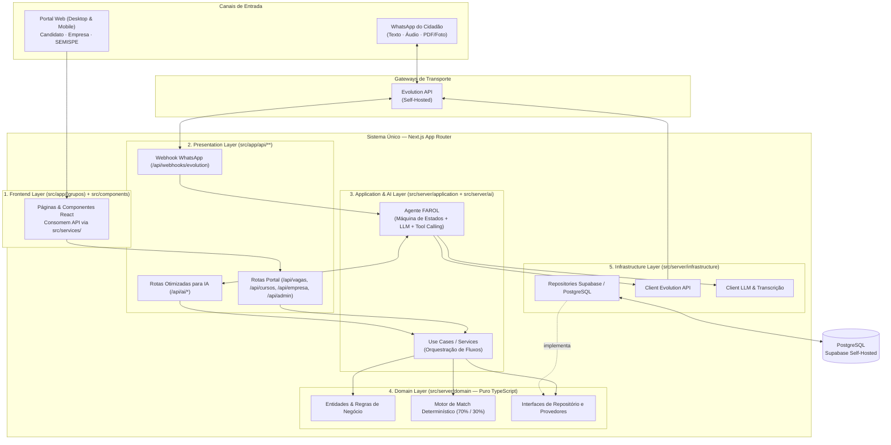

# 01. Arquitetura do Sistema, Stack e Estrutura Modular — FAROL

> **Projeto:** **FAROL** — *Formação, Ações e Rede de Oportunidades Locais*  
> **Contexto:** Hackathon UNDB + SEMISPE (São Luís do Futuro — Desafio 4)  
> **Fontes de Origem:** [GO_Sao_Luis_Mapeamento_Frontend.md](./contexto/GO_Sao_Luis_Mapeamento_Frontend.md) e [SLZ_Emprega_Comportamento_IA_WhatsApp.pdf](./contexto/SLZ_Emprega_Comportamento_IA_WhatsApp.pdf)

Este documento define a arquitetura oficial do **FAROL** como um **sistema único, profissional e sem adaptações**, reunindo em uma mesma base de código **Next.js (App Router)** o portal web (Candidatos, Empresas e SEMISPE), a API REST, os serviços de consulta da **IA FAROL** e a integração com **PostgreSQL (Supabase Self-Hosted)** e **WhatsApp (Evolution API)**.

---

## 1. Princípios Arquiteturais

1. **Fonte Única da Verdade:** O portal web e a IA FAROL no WhatsApp operam sobre o mesmo banco de dados e pelas mesmas regras de negócio. Não existem bancos paralelos, planilhas intermediárias ou bots desconectados.
2. **Separação Estrita de Responsabilidades:** Embora o projeto utilize o Next.js App Router como plataforma unificada, **Frontend**, **Backend (API/Domínio)**, **Banco de Dados** e **Orquestração de IA** são isolados em camadas bem definidas.
3. **API Orientada à IA (AI-Ready):** Além das rotas tradicionais do portal, o backend expõe endpoints dedicados e determinísticos (`/api/ai/*`) projetados para consumo direto pela IA FAROL (tool calling), retornando respostas enxutas, auditáveis e estruturadas.
4. **Código Determinístico vs. LLM:** Cálculos de compatibilidade (match), elegibilidade, máquina de estados, consentimento LGPD e ranking de cursos são executados exclusivamente em código TypeScript determinístico. A LLM nunca calcula scores nem inventa vagas ou cursos.
5. **Segurança e Privacidade (Zero Trust no Cliente):** Credenciais do Supabase (`SUPABASE_SERVICE_ROLE_KEY`), chaves de LLM e tokens da Evolution API residem exclusivamente no servidor (`src/server/`). O navegador consome apenas a API HTTP do Next.js.

---

## 2. Stack Tecnológica Oficial

| Camada | Tecnologia | Papel no Sistema |
| :--- | :--- | :--- |
| **Linguagem** | **TypeScript** (Strict Mode) | Tipagem estrita ponta a ponta entre banco, domínio, API, IA e interface React. |
| **Aplicação Full-Stack** | **Next.js (App Router)** + React | Renderização híbrida (RSC/Client), *Route Groups* por perfil e *Route Handlers* (`/api/**`) para backend e webhooks. |
| **Estilização & UI** | **Tailwind CSS** + Design System Parque Tecnológico | Implementação fiel dos tokens visuais do Brandbook oficial (Outfit + Inter, mobile-first, acessibilidade). |
| **Banco de Dados** | **PostgreSQL (Supabase Self-Hosted)** | Persistência relacional, integridade referencial, histórico imutável de candidaturas e estado de conversas WhatsApp. |
| **Conexão WhatsApp** | **Evolution API** | Gateway oficial self-hosted para recebimento de webhooks (texto, áudio, PDF/imagem) e envio de mensagens no WhatsApp. |
| **Inteligência Artificial** | **LLM Provider Desacoplado** (Gemini / Claude) | Compreensão de linguagem natural, transcrição/extração de currículo e redação empática com base nos dados do backend. |
| **Validação & Contratos** | **Zod** | Validação de entradas HTTP, payloads da Evolution API, parâmetros de ferramentas da IA e variáveis de ambiente. |
| **Infraestrutura** | **Docker + Coolify (VPS)** | Containers isolados para Aplicação Next.js, Supabase Self-Hosted e Evolution API com HTTPS. |

---

## 3. Diagrama da Arquitetura Unificada



---

## 4. Separação Interna de Pastas (Monolito Modular)

A organização de diretórios impõe fronteiras claras para que frontend, backend, banco e IA evoluam sem acoplamento:

```text
farol/
├── supabase/
│   ├── migrations/
│   │   └── 20261115000001_init_farol.sql # Migration inicial (PostgreSQL / Supabase)
│   └── seed.sql                          # Dados iniciais demonstrativos e perfis base
├── docs/                                # Documentação técnica de engenharia (01 a 05)
├── public/                              # Logos oficiais (Parque Tecnológico / FAROL)
├── src/
│   ├── app/                             # Next.js App Router (Rotas UI e API)
│   │   ├── (publico)/                   # /, /vagas, /vagas/[id], /cursos, /cursos/[id], /sobre
│   │   ├── (auth)/                      # /entrar, /cadastro, /cadastro/pessoa, /cadastro/empresa
│   │   ├── (candidato)/                 # /painel, /meu-curriculo, /minhas-candidaturas, /meus-cursos, /perfil
│   │   ├── (empresa)/                   # /empresa, /empresa/vagas, /empresa/servicos, /empresa/perfil
│   │   ├── (admin)/                     # /admin, /admin/empresas, /admin/usuarios, /admin/vagas, /admin/cursos, /admin/indicadores
│   │   └── api/                         # Backend HTTP Route Handlers
│   │       ├── auth/                    # Login, registro e sessão
│   │       ├── vagas/                   # Catálogo, criação e match autenticado
│   │       ├── cursos/                  # Catálogo, turmas, inscrições e pedidos
│   │       ├── candidato/               # Currículo estruturado, PDF e candidaturas
│   │       ├── empresa/                 # Gestão de vagas, candidatos e Serviços
│   │       ├── admin/                   # Gestão SEMISPE, turmas, ranking de demanda e indicadores
│   │       ├── ai/                      # Endpoints dedicados para consulta/ação da IA FAROL
│   │       └── webhooks/evolution/      # Receptor oficial de eventos da Evolution API
│   ├── components/                      # Componentes visuais reutilizáveis (Design System)
│   ├── services/                        # Clientes HTTP tipados consumidos exclusivamente pelo Frontend
│   ├── types/                           # DTOs e contratos compartilhados Front <-> API
│   └── server/                          # Código exclusivamente server-side (nunca importado no Client)
│       ├── config/                      # Env validado com Zod e clientes singleton
│       ├── domain/                      # Puro TypeScript (sem Next/Supabase): Entidades, Match 70/30, Erros
│       ├── application/                 # Casos de uso (orquestram domain + repositories)
│       ├── ai/                          # Orquestrador FAROL, prompts, máquina de estados e tool definitions
│       └── infrastructure/              # Implementações Supabase, Evolution API, LLM e gerador de PDF
├── .env.example                         # Modelo de variáveis de ambiente
├── package.json
└── tsconfig.json
```

### Regra de Ouro de Dependências

* `src/components/` e `src/app/(grupos)/` **nunca** importam `src/server/`. Toda comunicação ocorre via HTTP (`src/services/` → `/api/*`) ou via Server Components chamando `application/` de forma controlada.
* `src/server/domain/` **nunca** importa Next.js, Supabase, Evolution ou SDKs de LLM. Contém apenas TypeScript puro testável em milissegundos.
* `src/server/ai/` **nunca** executa queries SQL diretas; toda leitura e escrita no sistema passa pelos `UseCases` / API `/api/ai/*`, garantindo que as mesmas validações de negócio do portal valham para o WhatsApp.

---

## 5. Variáveis de Ambiente Necessárias

```env
# Aplicação
NEXT_PUBLIC_APP_URL=http://localhost:3000
JWT_SECRET=chave-jwt-forte-aleatoria

# Banco de Dados (Supabase Self-Hosted - Exclusivo Server-Side)
SUPABASE_URL=https://supabase.sua-vps.com.br
SUPABASE_SERVICE_ROLE_KEY=eyJ...

# Evolution API (WhatsApp Self-Hosted - Exclusivo Server-Side)
EVOLUTION_API_URL=https://evolution.sua-vps.com.br
EVOLUTION_API_KEY=sua-chave-global-ou-instancia
EVOLUTION_INSTANCE_NAME=farol-whatsapp
EVOLUTION_WEBHOOK_SECRET=segredo-validacao-webhook

# IA FAROL (LLM & Áudio - Exclusivo Server-Side)
LLM_PROVIDER=gemini
LLM_API_KEY=sua-api-key
AI_INTERNAL_API_KEY=chave-interna-para-rotas-ai
```
