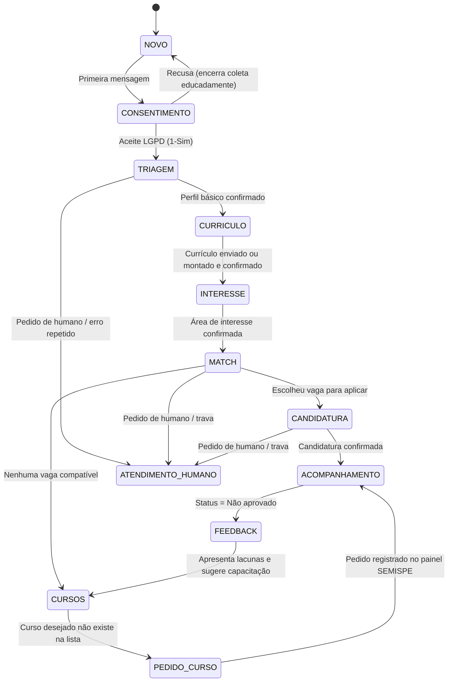

# 02. Regras de Negócio, Motor de Match e Comportamento da IA FAROL

> **Projeto:** **FAROL** — *Formação, Ações e Rede de Oportunidades Locais*  
> **Escopo:** Consolidação das regras operacionais do portal web e do agente conversacional **FAROL** no WhatsApp.

---

## 1. Perfis de Acesso e Matriz de Permissões (RBAC)

O FAROL opera como um **portal único** com visões e permissões distintas por perfil:

| Perfil | Papel no Sistema | Permissões Principais | Restrições Rígidas |
| :--- | :--- | :--- | :--- |
| **Visitante** | Usuário não autenticado | Consultar catálogo público de vagas e cursos, página Sobre, criar conta e fazer login. | Não vê score de match; não se candidata; não solicita inscrição/interesse em cursos. |
| **Candidato** (`CANDIDATO`) | Pessoa física em busca de vaga ou capacitação | Gerir perfil e currículo estruturado (manual, upload ou IA), gerar PDF, consultar **próprio score de match**, candidatar-se, acompanhar candidaturas, solicitar inscrição em turmas, registrar interesse sob demanda, vincular WhatsApp. | Não vê dados de outras pessoas físicas; não publica vagas. |
| **Empresa / Startup** (`EMPRESA`) | Organização com CNPJ ativo (inclui MEI) | Cadastrar/editar vagas próprias, visualizar candidaturas **apenas das próprias vagas**, atualizar etapa operacional permitida, pesquisar profissionais autorizados na aba **Serviços**. | **Nunca visualiza o score de compatibilidade** dos candidatos; não vê candidaturas de outras empresas; não acessa dados privados sem consentimento. |
| **Admin SEMISPE** (`ADMIN_SEMISPE`) | Gestão pública do programa | Administrar empresas, vagas, usuários, cursos e turmas programadas; confirmar/recusar matrículas; registrar frequência/conclusão/certificação; visualizar ranking de pedidos de curso e indicadores. | Respeitar LGPD; não editar currículo pessoal nem alterar consentimento do cidadão. |

---

## 2. Regras de Domínio do Portal

### 2.1 Cadastro e Autenticação
* **Cadastro Próprio:** O MVP utiliza autenticação própria (e-mail/telefone + senha hash). Não depende de Gov.br ou CadÚnico federal.
* **Empresas / Startups:** Cadastro gratuito exigindo **CNPJ ativo** (MEI é aceito como mínimo para startups) e validação cadastral básica, sem fluxo artificial de bloqueio manual obrigatório caso o CNPJ esteja regular.
* **Território:** Implantação inicial prioriza a região **Itaqui-Bacanga**, mas **sem bloqueio geográfico** para moradores de outros bairros de São Luís.

### 2.2 Currículo e Perfil Profissional
* O **perfil estruturado no banco de dados** é a fonte oficial para o matching e para a geração de PDF.
* **Importação (PDF/Imagem) ou Montagem via IA:** Os dados extraídos **devem ser exibidos para confirmação explícita do candidato** antes de sobrescrever o perfil oficial.
* **Experiência Não Obrigatória:** Candidatos sem experiência formal podem completar o currículo informando trabalhos informais, bicos, projetos ou cursos.

### 2.3 Vagas e Candidaturas
* **Requisitos Estruturados:** Toda vaga deve separar requisitos em **Obrigatórios** (incluindo escolaridade mínima) e **Desejáveis**, permitindo o cálculo determinístico de compatibilidade.
* **Pipeline de Candidatura:**
  `INSCRITO` → `EM_ANALISE` → `ENTREVISTA` → `CONTRATADO`  
  Saídas alternativas: `DESISTENCIA` (iniciada pelo candidato) e `NAO_APROVADO`.
* **Auditoria Imutável:** Toda transição de estado na candidatura gera um registro histórico com ator, data/hora e observação.
* **Unicidade:** Um candidato não pode se candidatar duas vezes à mesma vaga. Vagas encerradas/expiradas bloqueiam novas candidaturas.

### 2.4 Cursos, Turmas e Pedidos Sob Demanda
* **Turma Programada:** Possui cronograma, local, carga horária e capacidade. O cidadão envia uma **Solicitação de Inscrição** (`AGUARDANDO_CONFIRMACAO`), que só vira matrícula após aprovação da **SEMISPE**.
* **Curso Sob Demanda:** Sem data definida. O cidadão registra **Interesse** (`INTERESSE_REGISTRADO`), o que **não** constitui matrícula nem reserva de vaga.
* **Ranking de Demanda:** Pedidos de novos cursos (feitos no portal ou pela IA FAROL no WhatsApp) são acumulados e ranqueados por tema e bairro no painel da SEMISPE para subsidiar a abertura de novas turmas.

### 2.5 Diretório "Serviços" (Para Empresas)
* Permite que empresas busquem profissionais por categoria de atuação, competência e bairro.
* **Opt-in Obrigatório:** Só exibe perfis de candidatos que marcaram explicitamente `visivel_servicos = true`. Não implementa pagamentos, orçamentos ou marketplace financeiro nesta versão.

---

## 3. Motor Determinístico de Compatibilidade (Match)

O cálculo do score **é 100% executado em código TypeScript** (`src/server/domain/matching/`), garantindo transparência e auditabilidade:

1. **Pesos Oficiais:**
   * **70%** — Requisitos **Obrigatórios** (escolaridade mínima exigida + competências/certificações marcadas como obrigatórias).
   * **30%** — Requisitos **Desejáveis** (competências, cursos ou diferenciais desejáveis).
2. **Regra da Localização:** Bairro, região ou distância até a empresa **NUNCA entram no cálculo numérico do score**. A localização é exibida separadamente como apoio à decisão de deslocamento.
3. **Saída Explicável:** O motor nunca devolve apenas um número; ele retorna obrigatoriamente:
   * `percentual` (0 a 100)
   * `atendidos[]` (lista exata do que o candidato cumpre)
   * `naoIdentificados[]` (lacunas classificadas em: *conhecimento*, *requisito* ou *certificação*)
   * `obrigatoriosPendentes[]` (alerta claro caso falte algum requisito eliminatório, sem impedir que o candidato decida se inscrever)

---

## 4. Comportamento e Regras da IA FAROL (WhatsApp via Evolution API)

A assistente virtual no WhatsApp se chama **FAROL** (substituindo o nome provisório anterior). Seu papel é ser a porta de entrada acolhedora e acessível para moradores com pouca prática digital.

### 4.1 Personalidade e Estilo de Mensagem
* **Tom:** Acolhedor, simples, respeitoso e sem jargões técnicos (dizer *"o que falta pra vaga"* em vez de *"gap de competências"*).
* **Uma Pergunta por Vez:** Nunca enviar duas perguntas na mesma mensagem.
* **Mensagens Curtas:** Máximo de **3 a 4 linhas** por balão. Listas limitadas a no **máximo 3 itens por vez** (vagas, cursos ou requisitos).
* **Opções Numeradas:** Sempre que possível, oferecer respostas rápidas (`1`, `2`, `3`) além de texto livre.
* **Confirmação Antes de Gravar:** Tudo o que o usuário disser (especialmente via áudio ou texto livre) é resumido e só é gravado no banco após confirmação (`"1 para SIM"`).
* **Emojis:** No máximo **1 emoji** por mensagem, apenas para acolhimento (ex: 👋, ✅).

### 4.2 Regras Invioláveis da IA FAROL
1. **Nunca promete vaga, entrevista ou contratação.** Usa sempre *"chance"*, *"combina"*, *"você pode se candidatar"*.
2. **Nunca inventa vaga, requisito ou curso.** Só apresenta registros reais retornados pela API (`/api/ai/*`). Vagas de demonstração exibem explicitamente o selo *"exemplo/simulado"*.
3. **LGPD e Privacidade Estrita:**
   * Pede consentimento explícito na abertura antes de coletar dados, registrando data/hora no banco.
   * **Nunca solicita CPF, dados de saúde, religião ou raça.** Se o usuário enviar espontaneamente, a IA **não grava**, descarta da memória e avisa que não precisa dessa informação.
   * Permite solicitar a exclusão dos dados a qualquer momento.
   * **Nunca solicita senha** pelo WhatsApp. A vinculação com a conta do portal ocorre por código/link temporário seguro.
4. **Escalonamento Humano:** Se a conversa travar, o usuário demonstrar frustração ou solicitar ajuda humana, a IA altera o estado para `ATENDIMENTO_HUMANO` e encaminha para a equipe da SEMISPE.

### 4.3 Divisão de Responsabilidades: Código vs. LLM

| Executado por Código Determinístico (`domain` / `application`) | Executado pela IA FAROL (`LLM`) |
| :--- | :--- |
| Cálculo do score de match (70% obrigatórios / 30% desejáveis) | Entender texto livre e áudio transcrito |
| Regras de elegibilidade (ex.: escolaridade) | Extrair dados estruturados de currículo (PDF/foto) |
| Consulta oficial de vagas e cursos da SEMISPE | Redigir currículo honesto a partir da conversa |
| Persistência de perfil, candidaturas e pedidos de curso | Explicar o score e o feedback de não aprovação com empatia |
| Máquina de estados da conversa e registro de consentimento LGPD | Conduzir a conversa passo a passo e adaptar o tom |
| Contagem e ranking de pedidos de curso no painel SEMISPE | Reconhecer intenções (dúvida, frustração, pedido de humano) |

### 4.4 Máquina de Estados da Conversa (10 Etapas)

* **Retomada de Sessão:** O estado atual (`estado_atual`) e o progresso parcial (`contexto_json`) são salvos no PostgreSQL a cada interação. Se o morador parar no meio e voltar dias depois, a IA retoma exatamente de onde parou.
* **Áudio e Documentos:** Áudios recebidos via Evolution API são transcritos, resumidos em linguagem simples e confirmados antes da gravação. Currículos em PDF/imagem passam pelo mesmo fluxo de extração + confirmação campo a campo se necessário.
