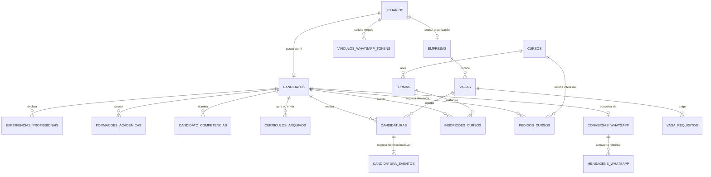

# 03. Modelagem do Banco de Dados (PostgreSQL / Supabase Self-Hosted) — FAROL

> **Projeto:** **FAROL** — *Formação, Ações e Rede de Oportunidades Locais*  
> **SGBD:** PostgreSQL 15+ (via **Supabase Self-Hosted**)  
> **Migration Oficial:** [supabase/migrations/20261115000001_init_farol.sql](../supabase/migrations/20261115000001_init_farol.sql)  
> **Seed Inicial:** [supabase/seed.sql](../supabase/seed.sql)

Este documento descreve o Diagrama Entidade-Relacionamento (DER), o dicionário de dados e as garantias de integridade do banco único compartilhado entre o **Portal Web** e a **IA FAROL (WhatsApp / Evolution API)**.

---

## 1. Diagrama Entidade-Relacionamento (DER)

---

## 2. Decisões de Modelagem

1. **Fonte Única para Portal e WhatsApp:** Não há tabelas separadas para "usuários do bot" e "usuários do site". Uma conversa no WhatsApp (`conversas_whatsapp`) pode iniciar antes mesmo do cadastro completo na web e se vincular perfeitamente a `candidatos` / `usuarios` por telefone verificado ou token temporário (`vinculos_whatsapp_tokens`).
2. **Privacidade / LGPD por Design:**
   * A tabela `candidatos` **não possui coluna de CPF, dados de saúde, religião ou raça**, impedindo estruturalmente a coleta indevida pela IA.
   * Campos explícitos `consentimento_lgpd` e `consentimento_em` registram o aceite antes da coleta.
   * `visivel_servicos` controla o opt-in para o diretório **Serviços** das empresas.
3. **Motor de Match Estruturado:** `vaga_requisitos` e `candidato_competencias` normalizam requisitos obrigatórios vs. desejáveis e escolaridade, permitindo cálculo determinístico auditável (70% obrigatórios / 30% desejáveis) sem depender de texto livre.
4. **Trilha de Auditoria Imutável:** Uma trigger no PostgreSQL bloqueia `UPDATE` e `DELETE` na tabela `candidatura_eventos`, preservando toda a trajetória de seleção.
5. **Selo de Demonstração:** `vagas.selo_simulado` e `cursos.selo_simulado` identificam registros fictícios usados em testes/apresentação.

---

## 3. Resumo das Entidades Principais

| Grupo | Tabelas | Finalidade |
| :--- | :--- | :--- |
| **Acesso & Vínculo** | `usuarios`, `vinculos_whatsapp_tokens` | Autenticação própria (JWT/sessão), papéis (`CANDIDATO`, `EMPRESA`, `ADMIN_SEMISPE`) e vinculação segura de WhatsApp sem senha no chat. |
| **Candidato & Currículo** | `candidatos`, `experiencias_profissionais`, `formacoes_academicas`, `candidato_competencias`, `curriculos_arquivos` | Perfil estruturado (fonte do match), histórico profissional (inclui informal), competências e versões de PDF enviado/gerado. |
| **Empresas & Vagas** | `empresas`, `vagas`, `vaga_requisitos` | Cadastro com CNPJ/MEI, publicação de vagas internas ou externas guiadas e requisitos estruturados (obrigatório/desejável). |
| **Seleção & Auditoria** | `candidaturas`, `candidatura_eventos` | Candidatura única por vaga, canal de origem (`WEB`/`WHATSAPP`), score calculado (restrito ao candidato/SEMISPE) e histórico imutável. |
| **Cursos & Demanda** | `cursos`, `turmas`, `inscricoes_cursos`, `pedidos_cursos` | Cursos programados vs. sob demanda, aprovação pela SEMISPE, frequência/certificado e ranking de pedidos de novos cursos. |
| **IA FAROL (WhatsApp)** | `conversas_whatsapp`, `mensagens_whatsapp` | Persistência da máquina de estados (10 etapas), contexto parcial para retomada de conversa, escalonamento humano e log de mensagens. |

---

## 4. Views e Índices Estratégicos

* **`vw_ranking_pedidos_cursos`:** Agrega `pedidos_cursos` por tema normalizado e bairro, contabilizando o volume de cidadãos interessados para apoiar a SEMISPE na abertura de novas turmas.
* **Índices:** Índices compostos em `vagas(status, bairro, modalidade)`, `candidaturas(candidato_id, status)`, `conversas_whatsapp(telefone)` e `pedidos_cursos(tema_desejado)` garantem respostas rápidas tanto nas listagens do portal quanto nas consultas em tempo real da IA FAROL.

> O código SQL completo com `ENUM`s, constraints, triggers de `atualizado_em`, trigger de imutabilidade e views está disponível em [supabase/migrations/20261115000001_init_farol.sql](../supabase/migrations/20261115000001_init_farol.sql).
