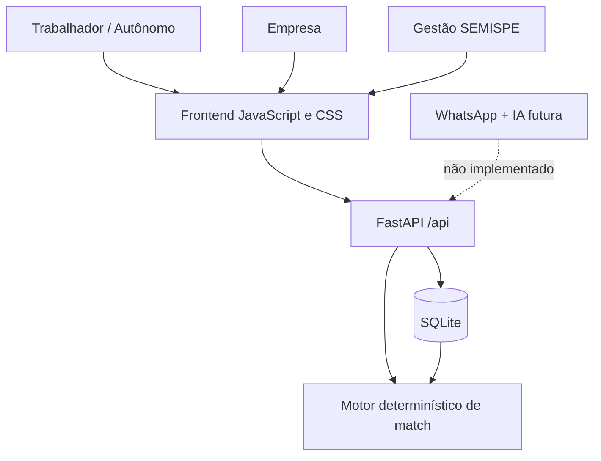

# Arquitetura técnica (MVP)



## Stack

- **Frontend:** HTML5, CSS3 responsivo, JavaScript ES Modules, sem `npm`, bibliotecas CSS ou build obrigatório.
- **Backend:** Python 3.10+ e FastAPI, documentação Swagger em `/docs`.
- **Banco:** SQLite; inicialização da estrutura e dados fictícios automaticamente no primeiro uso.
- **Autenticação de MVP:** sessões com token aleatório armazenado como SHA-256, senha PBKDF2-HMAC-SHA256. Sem login externo. O token é armazenado no `localStorage` no frontend apenas para demonstração; em produção migrar para solução de sessão segura com cookies HttpOnly, SameSite e proteção CSRF.
- **Controle de acesso:** perfis worker/company/admin verificados por rota. Uma empresa só vê currículos de seus candidatos e deve ser validada para publicar vagas.
- **Matching:** fórmula local e transparente em `backend/app/matching.py`, sem modelos generativos.

## Estrutura

```
conecta-slz/
├── start.py                      # Inicia aplicação
├── iniciar-windows.bat           # Instala dependências e abre no Windows
├── Dockerfile / compose.yaml     # Deploy isolado
├── backend/
│   ├── requirements.txt
│   ├── app/
│   │   ├── main.py               # Rotas API, regras de acesso
│   │   ├── database.py           # Esquema e acesso SQLite
│   │   ├── security.py           # Hash de senha e tokens
│   │   ├── matching.py           # Score explicável
│   │   └── seed.py               # Dados inteiramente fictícios
│   └── tests/                    # Testes automatizados
├── frontend/
│   ├── index.html                # Ponto de entrada
│   ├── assets/styles.css         # Toda identidade visual e responsividade
│   ├── assets/favicon.svg        # Ícone original
│   └── js/
│       ├── main.js               # Rotas, navegação, ações e estado
│       ├── api.js                # Cliente HTTP da API
│       ├── ui.js                 # Componentes HTML, sanitização e ícones
│       └── pages/
│           ├── home.js            # Página inicial
│           ├── jobs.js            # Vagas e detalhes
│           ├── courses.js         # Cursos e inscrições
│           ├── worker.js          # Área do trabalhador, currículo, feedback
│           ├── company.js         # Empresa, seleção de candidatos
│           ├── admin.js           # Gestão SEMISPE e análise de demandas
│           ├── services.js        # Profissionais autônomos
│           ├── auth.js            # Login e cadastro
│           └── info.js            # Sobre e FAQ
├── integrations/whatsapp.py     # Ponto de extensão futuro
├── docs/                         # Mapeamento, arquitetura e API
└── data/                         # SQLite gerado no primeiro uso
```

## Fluxos mais importantes

**Candidato:** cadastro -> perfil/currículo -> busca -> match -> candidatura -> status -> lacunas -> cursos -> sugestão de curso.

**Empresa:** cadastro -> validação SEMISPE -> vaga -> recebe candidaturas -> consulta perfil -> registra status/feedback.

**SEMISPE:** consulta métricas -> compara competências por vagas -> recebe solicitações -> identifica moradores únicos -> publica formação -> acompanha inscrições.

## Para mudar marca, região, cargos e currículo

- Marca: `frontend/js/main.js` (cabeçalho e rodapé) e `frontend/index.html` (título).
- Cores/fontes/layout: `frontend/assets/styles.css`, no bloco `:root`.
- Texto principal da home: `frontend/js/pages/home.js`.
- Vagas fictícias, empresas, cursos: `backend/app/seed.py`.
- Banco: `backend/app/database.py`.
- Regras de score: `backend/app/matching.py`.
- WhatsApp depois: `integrations/whatsapp.py` e endpoints próprios separados da autenticação de portal.

Se alterar seed após a primeira execução, apague **apenas o banco de demonstração**, `data/conecta.db`, com o servidor parado. Isso reinicia todos os dados de teste e sessões.

## Produção: trabalho que falta

Esta é uma base funcional de apresentação, **não um sistema pronto para operação municipal com dados reais**. Antes de publicar: avaliação LGPD e acessibilidade WCAG/eMAG, governança de cadastro, contratos com empresas, políticas de exclusão/retenção, registros de consentimento, rate limit, captcha, verificação de e-mail, autenticação robusta, logs de auditoria, backups, testes de carga e segurança, migração para PostgreSQL, segredos em cofre, observabilidade, versionamento de migrations, CI/CD e análise de viés dos scores.
