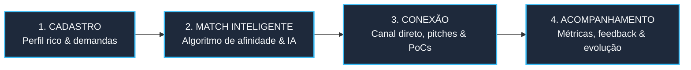

# Hackathon São Luís do Futuro — Desafio 04

> **Contexto:** Hackathon UNDB / Semispe — Inovação & Tecnologia  
> **Tema Sorteado:** Desafio 04 — Dificuldade de Conexão entre Talentos, Startups e Empresas  
> **Arquivo Fonte:** `docs/Desafio 4.pdf`

---

## 1. Visão Geral e Contextualização

O **Hackathon São Luís do Futuro** propõe desafios voltados à modernização, inclusão e desenvolvimento socioeconômico e tecnológico de São Luís. Entre os temas do ecossistema, nossa equipe foi sorteada com o **Desafio 04**, que ataca o gargalo crítico da articulação do ecossistema de inovação maranhense: a fragmentação entre quem produz conhecimento/habilidades (talentos), quem cria novos modelos ágeis de negócios (startups) e quem detém capital, demanda e escala (empresas consolidadas).

```
        ┌─────────────────────────────────────────────────────────────┐
        │            ECOSSISTEMA SÃO LUÍS DO FUTURO                  │
        │                                                             │
        │      ┌──────────┐         Gargalo de         ┌──────────┐   │
        │      │ Talentos │◄──────  Articulação  ─────►│ Startups │   │
        │      └────┬─────┘        & Integração        └────┬─────┘   │
        │           │                                       │         │
        │           └────────────────► ◄────────────────────┘         │
        │                              │                              │
        │                         ┌────▼─────┐                        │
        │                         │ Empresas │                        │
        │                         └──────────┘                        │
        └─────────────────────────────────────────────────────────────┘
```

---

## 2. Declaração Central do Desafio

### A Pergunta Norteadora (*How Might We*)
> **"Como conectar empresas, startups e talentos de forma inteligente, facilitando parcerias, contratações e novas oportunidades de negócios?"**

### Objetivo Principal
Desenvolver uma solução tecnológica que atue como ponte inteligente no ecossistema de inovação, reduzindo assimetrias de informação e fricções de busca para fomentar parcerias estratégicas, contratações baseadas em competências reais e geração de novos negócios.

---

## 3. Mapeamento das Dores (Pain Points)

O documento oficial estrutura o problema em três pilares fundamentais de dores:

| Pilar | Dor Declarada (Oficial) | Desdobramento Prático no Ecossistema |
| :--- | :--- | :--- |
| **1. Conexões** | *Dificuldade de encontrar parceiros e negócios compatíveis com as necessidades de cada organização.* | • Empresas e startups operam em silos isolados.<br>• Falta de compatibilidade (fit) estratégico, cultural e operacional.<br>• Inexistência de um ambiente confiável para Open Innovation e validação de MVPs/PoCs. |
| **2. Talentos** | *Falta de um canal integrado para identificar profissionais com competências adequadas às oportunidades.* | • Currículos estáticos não refletem competências práticas nem portfólio real.<br>• Estudantes e profissionais em transição não sabem onde encontrar oportunidades em startups locais.<br>• Dificuldade de identificar soft skills e sinergia de equipe. |
| **3. Oportunidades** | *Empresas e startups têm dificuldade de divulgar demandas e encontrar oportunidades de colaboração.* | • Demandas de mercado ficam reprimidas por falta de canais de divulgação especializados.<br>• Desperdício de oportunidades de fomento, compras públicas e privadas e aceleração.<br>• Startups gastam recursos excessivos em prospecção sem tração qualificada. |

---

## 4. O Fluxo de Solução Proposto

O desafio delineia uma esteira de 4 etapas essenciais para a experiência da solução:



### Detalhamento das Etapas

### 4.1. Cadastro
* **Para Talentos:** Perfil dinâmico baseado em competências comprovadas (stacks, projetos desenvolvidos, desafios superados na universidade/hackathons, objetivos de carreira e fit cultural).
* **Para Startups:** Apresentação da proposta de valor, estágio de maturidade, portfólio de soluções, desafios de produto e demandas de contratação/parceria.
* **Para Empresas:** Cadastramento de desafios corporativos reais (dores operacionais, teses de inovação aberta, demandas de contratação de squads ou profissionais específicos).

### 4.2. Match Inteligente
* **Motor de Recomendação:** Cruzamento multidimensional entre demandas corporativas, soluções de startups e competências de talentos.
* **Critérios de Afinidade:** Compatibilidade técnica, maturidade da solução, alinhamento de orçamento/modelo de contratação, proximidade regional (São Luís/Maranhão) e timing.
* **Transparência do Match:** Apresentação de um Score de Afinidade com explicação clara dos motivos do match (ex.: *"92% de afinidade: Solução IoT para logística portuária + Empresa tradicional com dor de rastreamento"*).

### 4.3. Conexão
* **Ambiente de Negociação Ágil:** Mecanismo integrado para solicitação de reuniões, envio de pitches estruturados ou propostas de projetos-piloto (PoCs).
* **Segurança e Confidencialidade:** Termos padronizados de cooperação mútua simplificados para destravar a primeira conversa.
* **Candidatura e Desafios Práticos:** Para talentos, a conexão ocorre via resolução de desafios rápidos das empresas, superando a triagem fria de currículos.

### 4.4. Acompanhamento
* **Pipeline de Parcerias:** Gestão visual (tipo Kanban) do status da conexão (Contato Inicial ➔ Reunião ➔ Proposta de Piloto ➔ Contratação / PoC Ativa ➔ Concluído).
* **Avaliação Mútua (Feedback Loop):** Avaliação de satisfação bilateral após interações, alimentando a reputação dos atores na plataforma e refinando os futuros algoritmos de match.
* **Métricas do Ecossistema:** Dados agregados de conexões geradas, empregos tech criados e parcerias consolidadas em São Luís.

---

## 5. Mapeamento de Personas

### Persona A: O Talento Universitário / Júnior (ex: Aluno UNDB)
* **Perfil:** Estudante ou recém-formado em Ciência da Computação, Sistemas de Informação, Engenharia ou Design.
* **Objetivo:** Ingressar no mercado tech local, atuar em startups desafiadoras e validar conhecimentos na prática.
* **Maior Frustração:** Falta de experiência formal exigida em plataformas genéricas de vagas (ex: LinkedIn, Gupy), processos seletivos impessoais.

### Persona B: O Fundador de Startup Early-Stage
* **Perfil:** Empreendedor de São Luís com produto em fase de validação ou tração.
* **Objetivo:** Encontrar clientes B2B piloto no Maranhão e atrair talentos motivados para compor o núcleo técnico.
* **Maior Frustração:** Dificuldade de acesso a decisores em grandes empresas e falta de recursos para disputar salários com empresas globais remotas.

### Persona C: O Gestor de Inovação / PME Consolidada
* **Perfil:** Diretor ou gerente de empresa tradicional (varejo, logística portuária, saúde, indústria ou agro local).
* **Objetivo:** Resolver problemas de eficiência e transformação digital com agilidade e baixo risco.
* **Maior Frustração:** Contratação lenta e cara de consultorias tradicionais; desconhecimento sobre as startups e talentos existentes na região.

---

## 6. Proposta de Valor e Diferenciais do Projeto

| Característica | Plataformas Tradicionais (LinkedIn, Gupy) | Nossa Proposta para o Hackathon |
| :--- | :--- | :--- |
| **Foco Geográfico e Ecossistêmico** | Global/Genérico, disperso | Foco no ecossistema local (São Luís & Maranhão) com expansão regional |
| **Modelo de Conexão** | Apenas emprego (vaga x currículo em PDF) | Tríade integrada: **Emprego + Parcerias B2B + Open Innovation** |
| **Mecanismo de Seleção** | Filtro de palavras-chave estáticas | Match por desafios reais, portfólio prático e algoritmo inteligente |
| **Pós-Match** | Conexão encerra no envio do CV | Acompanhamento do ciclo de vida da parceria/contratação com métricas |

---

## 7. Escopo Recomendado para o MVP (Hackathon)

Para a entrega e apresentação aos avaliadores, a solução deve focar no essencial com alto impacto visual e funcional:

1. **Onboarding Rápido & Segmentado:** Fluxo intuitivo para seleção de perfil (Talento, Startup ou Empresa).
2. **Feed / Mural de Demandas e Perfis:** Listagem inteligente de desafios corporativos e soluções de startups.
3. **Mecanismo de Match com IA / Heurística:** Demonstração interativa do cálculo de score de compatibilidade.
4. **Chat / Solicitação de Conexão:** Interface de interação com botão de ação rápida (*"Propor Solução"*, *"Conectar com Talento"*).
5. **Dashboard de Acompanhamento (Painel de Controle):** Visão geral de conexões ativas, status de parcerias e métricas de impacto no ecossistema.

---

## 8. Critérios de Avaliação e Estratégia de Pitch

Ao defender a solução perante a banca examinadora do Hackathon, enfatizar os seguintes eixos:

1. **Aderência Total ao Desafio:** Resolver exatamente as dores de Conexão, Talentos e Oportunidades presentes no PDF.
2. **Impacto Local (São Luís do Futuro):** Destacar como a ferramenta retém talentos no Maranhão, fortalece as startups maranhenses e moderniza as empresas tradicionais da cidade.
3. **Viabilidade Técnica e de Negócio:** Modelo de monetização sustentável (ex.: assinaturas corporativas para empresas, taxa de sucesso em PoCs contratadas, gratuidade para talentos) e tecnologia escalável.
4. **Demonstração Funcional:** Apresentar a jornada real dos 4 passos (`Cadastro` ➔ `Match Inteligente` ➔ `Conexão` ➔ `Acompanhamento`) funcionando no MVP.
